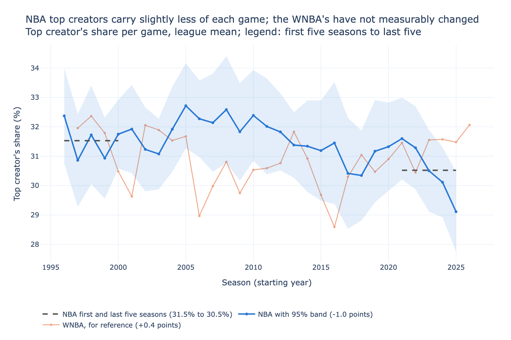
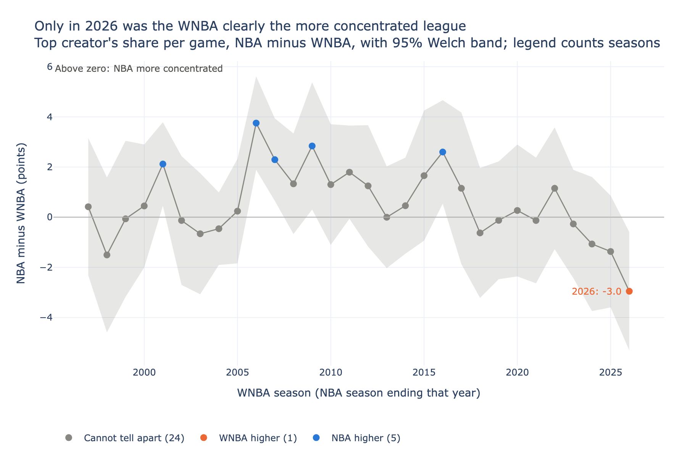
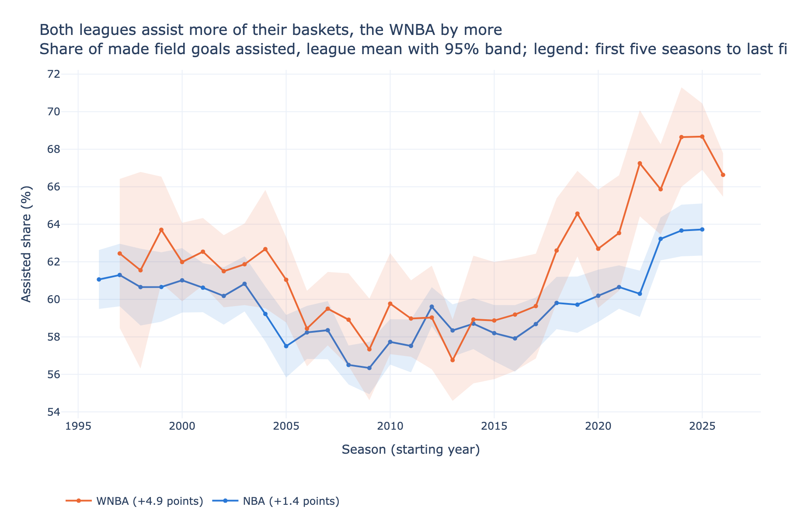

# Heliocentrism study

Did NBA offenses become solar systems, with one star creating most of the
scoring, and did the WNBA stay more egalitarian? This study measures how
concentrated shot creation is on every NBA team from 1996-97 to 2025-26 and
every WNBA team from 1997 to 2026, from the passer-scorer pair the
play-by-play records on every assisted basket.

Every made field goal is credited to one creator: the passer on an assisted
basket, the shooter on an unassisted one, weighted by the shot's points. For
each team the study measures the top creator's share of created points, the
top two's share, the effective number of creators (1 divided by the sum of
squared shares), and the assisted share. The primary versions are computed
per game and averaged over a team's games, so a star's missed games do not
dilute them; season-total versions sit alongside. Uncertainty: t intervals
across teams for league means, Welch intervals for changes and league gaps,
and an approximate F-based set for each hinge fit's break year.

Design, decisions, and data checks: `docs/design.md`. Data sources and
licenses: `DATA_SOURCES.md`. Family page:
https://ismayc.github.io/heliocentrism-study/

<!-- terms -->
> **Terms used in this analysis.** Dotted-underlined terms anywhere below repeat these definitions on hover ([full glossary](https://github.com/ismayc/basketball-data-science/blob/main/docs/glossary.md)).
>
> *(no specialized metric terms in this document)*
<!-- /terms -->

## Results

<!-- gen:results -->
Coverage: 35,492 NBA games (1996-97 to 2025-26) and 6,469 WNBA games (1997 to 2026), every regular-season game that passes the shared layer's score checks, with 1,838,338 assisted baskets. 993 passers (0.05%) could not be matched to a player and are left out. Parsed team assists equal LeagueGameLog's in at least 99.7% of team-games in every season except WNBA 1997 (92.1%) and WNBA 1998 (94.2%); made field goals match in at least 99.9%. Every table is computed in Python and again in R from the same events, and the two agree on every cell.

### 1. First five seasons against the last five

Team-season means; the change is last minus first with a 95% Welch interval (percentage points for shares, creators for counts):

| Measure | League | First | Last | Change |
|---|---|---|---|---|
| Top creator's share, per game | NBA | 31.5% | 30.5% | -1.0 (-1.9 to -0.1) |
| Top creator's share, per game | WNBA | 31.0% | 31.5% | +0.4 (-0.8 to +1.7) (includes zero) |
| Top two creators' share, per game | NBA | 51.4% | 50.5% | -0.9 (-1.9 to +0.1) (includes zero) |
| Top two creators' share, per game | WNBA | 52.0% | 52.1% | +0.2 (-1.4 to +1.7) (includes zero) |
| Effective number of creators, per game | NBA | 5.32 | 5.53 | +0.21 (+0.08 to +0.34) |
| Effective number of creators, per game | WNBA | 5.19 | 5.17 | -0.01 (-0.20 to +0.17) (includes zero) |
| Top creator's share, season totals | NBA | 25.9% | 22.0% | -3.9 (-5.3 to -2.5) |
| Top creator's share, season totals | WNBA | 24.8% | 25.2% | +0.4 (-1.8 to +2.5) (includes zero) |
| Top two creators' share, season totals | NBA | 41.8% | 37.8% | -4.0 (-5.6 to -2.3) |
| Top two creators' share, season totals | WNBA | 42.1% | 41.9% | -0.2 (-2.9 to +2.5) (includes zero) |
| Effective number of creators, season totals | NBA | 7.32 | 8.87 | +1.56 (+1.11 to +2.00) |
| Effective number of creators, season totals | WNBA | 6.93 | 7.18 | +0.25 (-0.24 to +0.74) (includes zero) |
| Assisted share of made field goals | NBA | 60.9% | 62.3% | +1.4 (+0.4 to +2.3) |
| Assisted share of made field goals | WNBA | 62.4% | 67.4% | +4.9 (+3.5 to +6.4) |

In the NBA the top creator's share per game fell, from 31.5% to 30.5%; in the WNBA it did not change measurably (31.0% to 31.5%). Season totals move further than per-game shares in the NBA, which is what a rise in games missed by top players would produce (not measured here). Assisted share rose in the NBA (60.9% to 62.3%): more baskets credited to a passer spreads creation, so part of the fall is how creation is counted, not only who has the ball (see Limits).

Hinge fits on the season means put the NBA's turn in 2008 (approximate 95% set 2005 to 2022; slope +0.08 points a season before, -0.12 after) and the WNBA's in 2016 (2006 to 2020; -0.09, then +0.19). Both sets are wide: the data date a drift, not a moment. Every measure's fit is in `output/breaks.csv`.



### 2. NBA against WNBA, season by season

On the top creator's share per game, the NBA was the more concentrated league, with a 95% Welch interval excluding zero, in 5 of 30 seasons (WNBA years 2001, 2006, 2007, 2009, and 2016), and the WNBA in 1 (2026). In 2026 the gap was -3.0 points (-5.3 to -0.6), NBA 2025-26 against WNBA 2026.





### 3. The most heliocentric team-seasons

By the top creator's share of the team's season created points; z is the same share against that league-season's teams (sample standard deviation):

**NBA**

| Rank | Season | Team | Top creator | Share | z |
|---|---|---|---|---|---|
| 1 | 2008-09 | NOH | C. Paul | 47.9% | 3.01 |
| 2 | 2016-17 | OKC | R. Westbrook | 46.8% | 2.65 |
| 3 | 2007-08 | NOH | C. Paul | 45.6% | 2.58 |
| 4 | 2016-17 | HOU | J. Harden | 44.5% | 2.36 |
| 5 | 2017-18 | OKC | R. Westbrook | 43.3% | 2.77 |
| 6 | 2001-02 | CLE | A. Miller | 41.9% | 2.31 |
| 7 | 2017-18 | CLE | L. James | 41.1% | 2.46 |
| 8 | 1998-99 | SEA | G. Payton | 40.9% | 2.10 |
| 9 | 2018-19 | HOU | J. Harden | 40.9% | 2.77 |
| 10 | 2004-05 | PHI | A. Iverson | 40.3% | 2.21 |

**WNBA**

| Rank | Season | Team | Top creator | Share | z |
|---|---|---|---|---|---|
| 1 | 2020 | CHI | C. Vandersloot | 39.6% | 2.71 |
| 2 | 2024 | IND | C. Clark | 39.5% | 1.94 |
| 3 | 2025 | PHX | A. Thomas | 37.2% | 2.08 |
| 4 | 2026 | PHX | A. Thomas | 37.0% | 1.71 |
| 5 | 2002 | ORL | S. Johnson | 36.8% | 1.81 |
| 6 | 2002 | SEA | S. Bird | 36.6% | 1.78 |
| 7 | 2003 | SEA | S. Bird | 36.6% | 1.70 |
| 8 | 1998 | SAC | T. Penicheiro | 36.6% | 1.46 |
| 9 | 1997 | HOU | C. Cooper | 36.1% | 1.45 |
| 10 | 2019 | CHI | C. Vandersloot | 36.1% | 2.08 |

Top 15 by share and by z, per league: `output/leaders.csv`.
<!-- /gen:results -->

## Limits

- An assist credits only the last pass. A drive and kick credits the kicker,
  and the pass before it (the "hockey assist") is invisible, so creation by
  primary ball handlers is undercounted. When assist rates rise, creation
  spreads by construction.
- Assists are a scorekeeper's judgment, and generosity varies by arena and
  era (the backlog's "scorekeeper fingerprints" idea), which this study does
  not adjust for.
- Free throws are left out: the feed records no assist on them, so a star who
  draws fouls creates more than these shares show.
- Regular season only. Team-seasons from the same franchise in one
  five-season block are treated as independent in the era comparison, so its
  intervals are somewhat narrow.
- Passers are matched by name text within the game and team. Under 0.2% of
  assisted baskets in any season stay unmatched and are left out; a
  confident wrong match is possible where two teammates share display text,
  though the resolver refuses any text that matches more than one player.

## Reproduce

The events come from the family's shared PlayByPlayV3 layer
(`../basketball-analysis-tools/pbp_history.py`).

```bash
python python/01_creation.py   # passer resolution, validation, points created
python python/02_metrics.py    # team-season metrics, trends, breaks, gaps
Rscript R/heliocentrism.R      # the same, independently, in R
python python/03_reconcile.py  # Python against R, every cell
python python/04_figures.py    # figures/
python python/05_report.py     # this README's results
python python/06_example_game.py  # one real team-game for the method diagram
python python/07_diagrams.py   # explainer diagrams (figures/*.svg)
bash run_checks.sh             # every gate
```

Raw play-by-play stays local (NBA.com terms); `output/` holds team-season
and player-season aggregates only, plus one illustrative team-game's
creator totals and two of its plays (`output/example_game.csv`,
`output/example_plays.csv`) for the method diagram.
